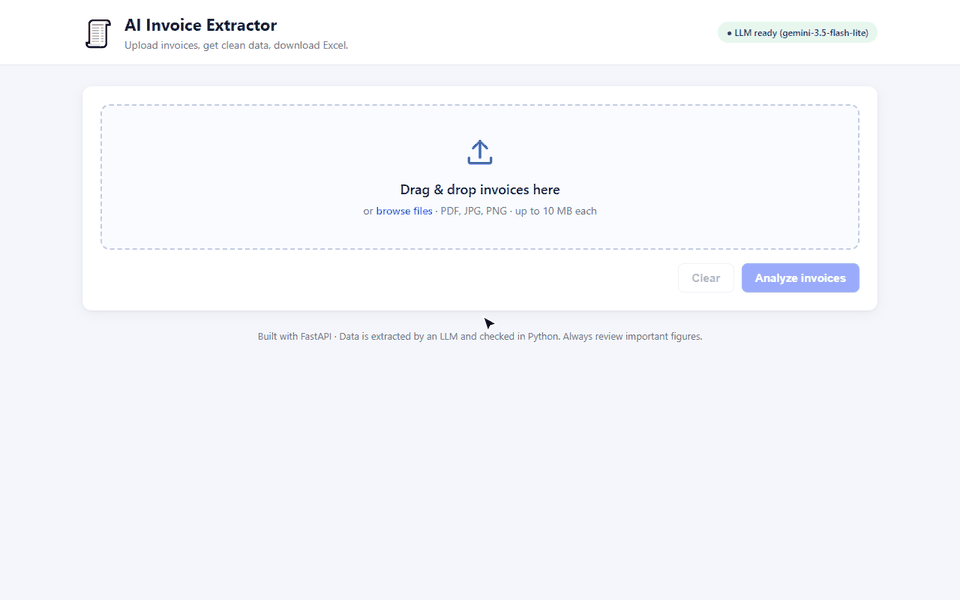
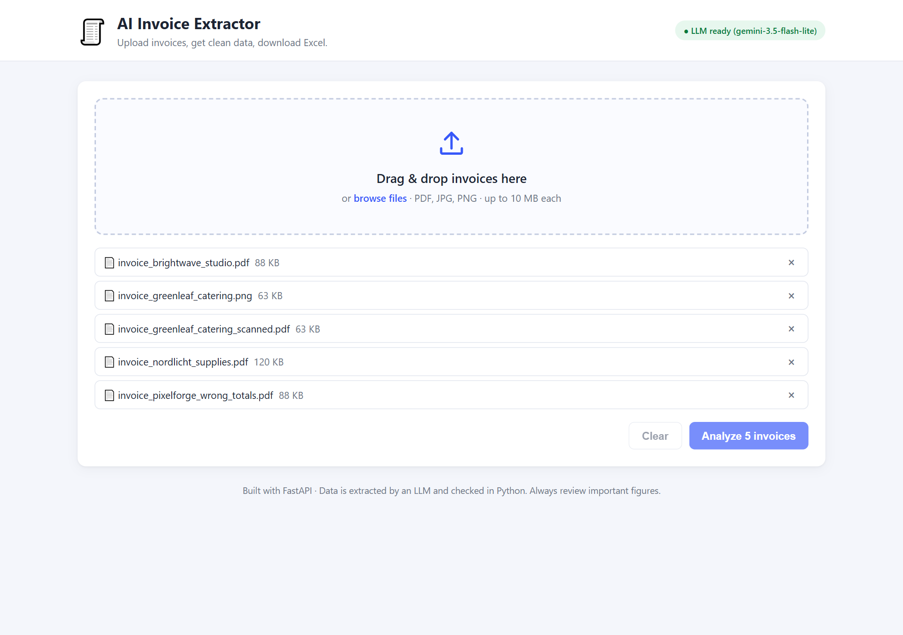
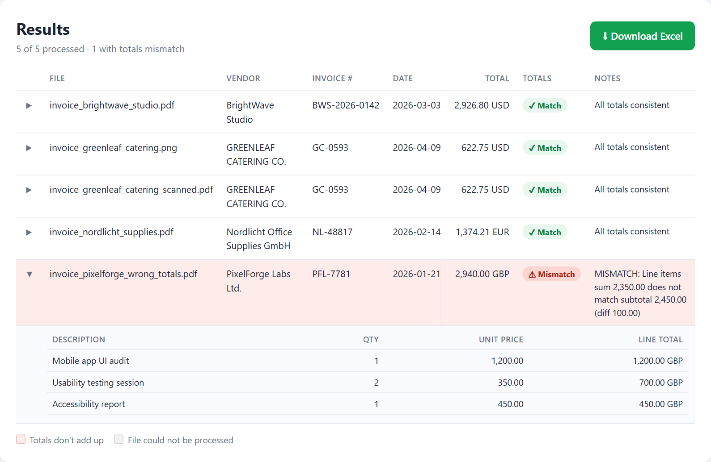
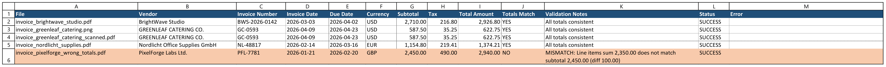
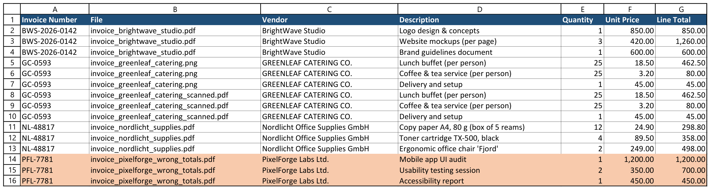
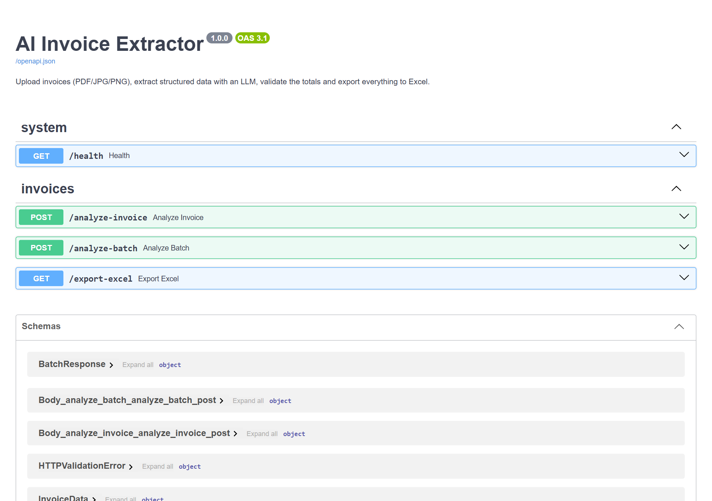

# 🧾 AI Invoice Extractor

Upload invoices (PDF, JPG or PNG). An LLM pulls out the important data as structured JSON, Python **double-checks the math**, and you download everything as one tidy **Excel file**.

It works with **any OpenAI-compatible LLM provider**, including several **free** ones (Google Gemini, GitHub Models, Groq, or a local Ollama model). Switching providers only means editing `.env`, with no code changes.

> ⚠️ All sample invoices in `samples/` are **fake**. Every company, person, address and number was made up for demonstration.



---

## 📸 Screenshots

**1. Upload.** Drag in several invoices at once (PDFs, scans or photos):



**2. Results.** Every invoice is extracted and checked. The one whose line items don't add up to its subtotal is flagged, with the reason:



**3. Excel export, "Invoices" sheet.** One row per invoice. The invoice whose totals don't add up is highlighted, with the reason:



**4. Excel export, "Line Items" sheet.** Every line item, linked to its invoice number:



**5. REST API.** Interactive docs at `/docs`, for connecting the extractor to other tools:



*The demo and screenshots show real output from Google Gemini (`gemini-3.5-flash-lite`, free tier) on the fake sample invoices.*

---

## ✨ Features

- **Drag-and-drop web page.** Upload several invoices, see the results in a table, and click **Download Excel**.
- **PDFs and images.**
  - Digital PDFs are read as text, which is fast and accurate.
  - Scanned, image-only PDFs are rendered to images automatically and sent to a vision model.
  - JPG and PNG photos also go to the vision model.
- **Structured output, validated with Pydantic:**
  - vendor, invoice number, invoice date and due date, currency;
  - line items (description, quantity, unit price, line total);
  - subtotal, tax and total.
- **Totals checked in Python, not by the AI.**
  - It checks that the line items add up to the subtotal and that subtotal + tax equals the total, within a small rounding tolerance.
  - Mismatches are flagged with a clear explanation, for example: `Line items sum 2,350.00 does not match subtotal 2,450.00 (diff 100.00)`.
- **Excel export with two sheets:** **Invoices** (one row per invoice) and **Line Items** (linked by invoice number). Rows whose totals don't match are highlighted in red.
- **Batch processing.** One broken file never stops the rest.
- **Robust error handling:**
  - unsupported, empty, oversized, corrupted or renamed files;
  - an LLM reply that isn't valid JSON (it retries once, then gives a clear error);
  - missing fields, which become `null` instead of crashing.
- **Messy formats cleaned up.**
  - Numbers like `1.234,50 €` or `$1,234.50` are parsed.
  - Dates become `YYYY-MM-DD`.
  - Currency symbols become ISO codes.
- **Logging, with no secrets.** API keys and file contents are never logged.
- **Tested.** 87 pytest tests, with the LLM mocked so no API key is needed.

## 🛠 Tech stack

Python 3.11+ · FastAPI · Uvicorn · Pydantic v2 · PyMuPDF · OpenAI-compatible SDK · pandas + openpyxl · python-dotenv · plain HTML/CSS/JS · pytest

## 📁 Project structure

```
invoice-extractor/
├── app/
│   ├── main.py           # FastAPI app and endpoints
│   ├── config.py         # settings from .env
│   ├── schemas.py        # Pydantic models + value cleaning (numbers, dates, currency)
│   ├── file_handler.py   # upload checks, PDF text extraction / page rendering
│   ├── llm_client.py     # provider-agnostic LLM call (the only network code)
│   ├── extractor.py      # prompt, JSON parsing, retry, full pipeline
│   ├── validators.py     # totals checks (pure Python)
│   ├── exporter.py       # Excel workbook builder
│   └── logging_config.py
├── static/               # web page (index.html, style.css, app.js)
├── scripts/make_samples.py
├── samples/              # fake demo invoices
├── tests/                # pytest suite (LLM mocked)
├── requirements.txt
└── .env.example
```

## 🚀 Setup

**1. Install** (Python 3.11 or newer):

```bash
cd invoice-extractor
python -m venv venv

# Windows
venv\Scripts\activate
# macOS / Linux
source venv/bin/activate

pip install -r requirements.txt
```

**2. Configure your LLM.** Copy the example file:

```bash
# Windows (PowerShell)
copy .env.example .env
# macOS / Linux
cp .env.example .env
```

Then open `.env` and fill in **one** provider. The recommended free option is Google Gemini:

1. Go to <https://aistudio.google.com/apikey>, sign in with a Google account and click **Create API key**.
2. Put it in `.env`:

```env
BASE_URL=https://generativelanguage.googleapis.com/v1beta/openai/
API_KEY=paste-your-key-here
MODEL_NAME=gemini-3.5-flash
```

Other free providers:

| Provider | BASE_URL | MODEL_NAME | Key |
|---|---|---|---|
| GitHub Models | `https://models.github.ai/inference` | `openai/gpt-4o-mini` | GitHub token with *Models: read* |
| Groq | `https://api.groq.com/openai/v1` | `meta-llama/llama-4-scout-17b-16e-instruct` | <https://console.groq.com> |
| Ollama (local, offline) | `http://localhost:11434/v1` | `qwen2.5vl:7b` | any text, e.g. `ollama` |

> The model **must support vision (images)**. Images and scanned PDFs are sent to it as pictures.
> Free tiers have rate limits, and some free providers may use the data you send. Use sample or non-sensitive invoices, or Ollama for full privacy.

**3. (Optional) Regenerate the sample invoices:**

```bash
python scripts/make_samples.py
```

## ▶️ Run

```bash
uvicorn app.main:app --reload
```

- Web page: <http://127.0.0.1:8000>
- Interactive API docs (Swagger): <http://127.0.0.1:8000/docs>

The badge in the top-right corner of the page shows whether the LLM is configured.

## 🔌 API usage

| Method | Endpoint | Description |
|---|---|---|
| `POST` | `/analyze-invoice` | One file, returns JSON |
| `POST` | `/analyze-batch` | Multiple files, returns `batch_id` plus a result per file |
| `GET` | `/export-excel?batch_id=…` | Downloads the batch as `.xlsx` (defaults to the latest batch) |
| `GET` | `/health` | Server status and whether an LLM is configured |

```bash
# Single invoice
curl -F "file=@samples/invoice_brightwave_studio.pdf" http://127.0.0.1:8000/analyze-invoice

# Batch
curl -F "files=@samples/invoice_brightwave_studio.pdf" \
     -F "files=@samples/invoice_pixelforge_wrong_totals.pdf" \
     -F "files=@samples/invoice_greenleaf_catering.png" \
     http://127.0.0.1:8000/analyze-batch

# Download Excel for that batch
curl -o invoices.xlsx "http://127.0.0.1:8000/export-excel?batch_id=<batch_id from above>"
```

**Example response** (`/analyze-invoice` with the deliberately wrong sample):

```json
{
  "filename": "invoice_pixelforge_wrong_totals.pdf",
  "status": "success",
  "source": "text",
  "data": {
    "vendor_name": "PixelForge Labs Ltd.",
    "invoice_number": "PFL-7781",
    "invoice_date": "2026-01-21",
    "due_date": "2026-02-20",
    "currency": "GBP",
    "line_items": [
      {"description": "Mobile app UI audit", "quantity": 1.0, "unit_price": 1200.0, "line_total": 1200.0},
      {"description": "Usability testing session", "quantity": 2.0, "unit_price": 350.0, "line_total": 700.0},
      {"description": "Accessibility report", "quantity": 1.0, "unit_price": 450.0, "line_total": 450.0}
    ],
    "subtotal": 2450.0,
    "tax": 490.0,
    "total_amount": 2940.0,
    "totals_match": false,
    "validation_notes": "MISMATCH: Line items sum 2,350.00 does not match subtotal 2,450.00 (diff 100.00)"
  },
  "error": null
}
```

Error responses use clear HTTP codes:
- `400`: unsupported, empty or corrupted file.
- `413`: file too large.
- `502`: the LLM failed or returned invalid JSON twice.
- `503`: the LLM is not configured.

In a batch, errors are reported per file instead.

## ⚙️ How it works

1. **Upload check.** The extension and the real file signature (magic bytes) are verified, along with empty and size limits.
2. **Content extraction.** PyMuPDF reads the PDF's text layer. If a page has almost no text, it's a scan, so the pages are rendered to PNG (up to `MAX_PDF_PAGES`). Images are used as they are.
3. **LLM extraction.**
   - The text or images are sent with a strict prompt: *return only JSON in this shape, use null for missing values, copy numbers exactly and don't fix totals*.
   - JSON mode is used when the provider supports it.
   - Code fences and extra chatter are stripped.
   - If the reply still isn't valid JSON, the model is asked **once** more, and then a clear error is returned.
4. **Cleaning and validation.** Pydantic converts numbers, dates and currencies into consistent types. Anything missing becomes `null`.
5. **Totals check, in Python.** Decimal math with a tolerance (`TOTALS_TOLERANCE`, default 0.02) sets `totals_match` and writes readable `validation_notes`. The LLM is never trusted to do arithmetic.
6. **Export.** pandas and openpyxl build the two-sheet workbook in memory, with styled headers, number formats, frozen headers, filters and red highlighting.

## 🧪 Tests

```bash
pytest
```

The tests cover:
- the validators: match, mismatch, rounding tolerance, missing values, float noise;
- value cleaning;
- the Excel exporter: sheets, rows, linking, highlighting;
- the extractor: JSON parsing, retry-once logic, the vision path, file errors;
- the LLM client: friendly messages for timeouts, network, auth and server errors, automatic wait-and-retry on rate limits, and the key never logged;
- the API endpoints.

The LLM is mocked everywhere, so **no API key is needed**.

## 🚧 Limitations and future improvements

- Accuracy depends on the chosen model. Small local models make more mistakes than large hosted ones.
- Handwritten or very low-quality scans may not extract well.
- Free tiers have rate limits. For example, the Gemini free tier for `gemini-3.5-flash` allows about 5 requests per minute and 20 per day (each model has its own quota; see <https://ai.dev/rate-limit>). When the provider says "rate limit, retry in N seconds", the app waits and retries automatically (`RATE_LIMIT_RETRIES`, `RATE_LIMIT_MAX_WAIT`), so big batches finish but take longer. If the daily quota is used up, the app says when it resets instead of waiting.
- Batch results are kept in memory (the last 20 batches), so they disappear when the server restarts.
- Only the first `MAX_PDF_PAGES` pages of scanned PDFs are sent to the vision model.
- **Ideas:**
  - a database and history page;
  - user accounts;
  - a Docker image;
  - per-field confidence scores;
  - currency conversion;
  - CSV / Google Sheets / QuickBooks export;
  - duplicate-invoice detection.

## 📄 License

MIT. Free to use and adapt.
